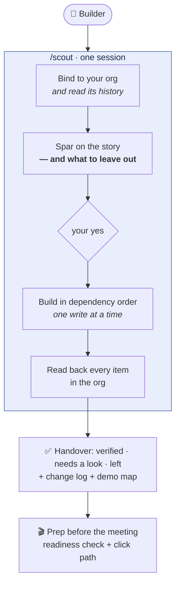

# SF Demo Scout

A plugin for anyone who builds Salesforce demos, for customers or for their own
stakeholders. It runs in Claude Code, Codex or Cursor; one of them is enough. Run
`/scout` and say what you need: Scout spars with you on the demo story, builds it in
your demo org, checks every piece there, and preps you for delivery, all in one
session. Scout 2.0 is built for Opus 5.5 and later, ideally at High effort or higher
(`/effort high`, or Effort in the desktop app's model picker). On Codex it's tested
with GPT-6.1-Sol at Extra High, and on Cursor with Opus 5.5 at High.

## Why Scout exists

Building on Salesforce is shifting. Demos and prototypes are increasingly
built in real Salesforce orgs through CLI-native AI tools that didn't exist
18 months ago, and the gap between what the platform now expects and what
most of us trained for is real. The tooling
landscape doesn't help: a dozen MCP servers, community skill repos, half a
dozen ways to stand up an AI coding tool. The cost of starting is high, and the
cost of starting wrong is higher.

Scout is the on-ramp. Setup stands up everything you need, and from there
`/scout` does four things:

1. **Works in the org you name.** It looks at exactly what your request
   touches (a full audit when you ask), so you build into reality instead of
   around it. If the org isn't connected yet, it opens Salesforce's login page
   for you. It never changes your existing logins, and changes your default org
   only on your yes, when Salesforce's deploy check needs one.
2. **Spars with you on the story.** From a one-liner or your discovery notes
   to a proposal with a clear "wow" moment, and pushback on anything that
   doesn't earn its place, because the real work is deciding what to leave out.
3. **Builds and checks the configuration.** In dependency order, one write at
   a time. It reads every item back in the org before calling it done, logs
   every change with rollback evidence, and asks before deleting or changing
   anything sensitive.
4. **Preps you for delivery.** The click path through your story, and a
   read-only readiness check before you present.

Scout works because it drives Salesforce's [official
skills](https://github.com/forcedotcom/sf-skills), straight from Salesforce's own
GitHub repository and kept current, with an orchestration layer for demo builders on top. Rather than improvising Apex, Flow
XML, or agent metadata from training data, it uses the same authoring
rules and validation patterns the platform team publishes, the day they
publish them. You're not vibe-coding the platform layer — you're driving it.

## How it works

One session from idea to a checked demo. The 5.5 models carry the whole job;
Scout supplies the Salesforce playbook (Salesforce's official skills, deployment
rules, Salesforce Docs) and a demo builder's rigour (org binding, confirmations, read-back,
per-customer history, and a log of what was done, with which skill, and why).



## What Scout builds — and what it leaves to you

Building used to be the hard part. It isn't anymore. Scout will attempt
anything the Metadata API can express — objects, flows, Apex, agents — and
loop on its own until it's deployed. Today's models configure Salesforce more
reliably than most of us do by hand.

So the scarce discipline has moved. When everything is buildable, the
question that decides whether a demo lands is no longer *can we build
this* — it's *what's worth building, and what to leave out*. That judgment
doesn't automate, and it's the whole reason `/scout` spars first: the point
of sparring is to decide what **not** to build before a line is deployed.

Building, by contrast, is deliberately low-friction. Once you've approved
the proposal, Scout goes as far as the platform allows without stopping to
re-litigate the plan — the second-guessing already happened, with you, in
sparring. The one thing it never does is *pretend*: where it can check its
own work (a deploy read-back, a passing test, a fired agent action) it
reports a verified green; where it can't (a rendered layout, a visual UX)
it still builds and deploys, then hands you a short QA checklist rather
than claim a green it couldn't earn. And it never touches existing
metadata, or anything destructive, without your say-so.

| Scout builds and verifies | Scout builds it — you stay in the loop |
|---|---|
| Custom objects, fields, record types | Lightning Web Components, one or several (deployed and checked; visual QA) |
| Permission sets (incl. companion sets) | Additions to existing Lightning record pages, page-layout arrangements, dashboards (deployed; visual QA) |
| Lightning apps, tabs, queues, reports | Screen, scheduled and platform-event flows, any screens and components (deployed Draft; QA, then activate) |
| Flows — record-triggered and autolaunched (Flow tests where Salesforce supports them) | Orchestration flows (deployed; you validate the lifecycle) |
| Apex — multi-class, cross-object (bounded test-fix loop) | Multi-agent wiring, channel assignment, OmniStudio (UI-only — Scout builds the metadata around them) |
| Agentforce agents (deploy, activate, smoke-test) | Anything destructive or on existing metadata — never without confirmation |

On an existing Lightning record page, Scout adds what you approve (a tab, a
component, a field section or fields) with Salesforce's official page skill,
then checks that everything already on the page is still where it was. It writes
nothing it can't ground in your org's own pages, Salesforce's references or the
docs. If your org rejects a component, Scout leaves it out and tells you how to
add it in App Builder; a second rejection ends the edit, so rejected components
cost at most three dry runs. Moving or removing what's already on a page needs
your yes. A new `RecordPage` from scratch is still yours to compose in App
Builder, where the whole page can be arranged and previewed.

## Install

You type in two places: a **terminal** (Terminal on macOS, PowerShell on Windows) and
your coding tool's **chat**. Each step below says which. If something fails, look up the
message in [Troubleshooting](docs/troubleshooting.md).

### On Windows (beta): the tools first

On Windows, setup names what's missing but installs nothing itself, so check these
first, in **PowerShell**:

1. **Git for Windows:** `git --version`. If it's missing: `winget install --exact --id Git.Git`.
2. **Python 3.9 or later:** `py -3 --version`. If it's missing or older:
   `winget install --exact --id Python.PythonInstallManager`, then, in a new
   PowerShell window, `pymanager install default`.
3. **Node 22.20 or later:** `node --version`. If it's missing or older:
   `winget install --exact --id OpenJS.NodeJS.LTS`.
4. **The Salesforce CLI, from npm:** `sf.cmd --version`. If it's missing:
   `npm.cmd install --global @salesforce/cli`. (In PowerShell, type `npm.cmd` and `sf.cmd`:
   plain `npm` and `sf` can start PowerShell scripts that Windows blocks by default.)
   If `where.exe sf` shows `C:\Program Files\sf`,
   that's the CLI's Windows installer, whose launcher breaks on quoted arguments from a
   coding tool's shell: uninstall **Salesforce CLI** in Settings → Apps (your saved logins
   stay), then run the npm line.
5. **jq:** `jq --version`. If it's missing: `winget install --exact --id jqlang.jq`.

After installing anything, open a new PowerShell window, and quit and reopen your
Claude, Codex or Cursor app, so they find the new commands.

Behind a company proxy, Git for Windows can refuse GitHub with "self-signed certificate
in certificate chain", so adding Scout's marketplace or cloning fails. Then tell Git to
use Windows' own certificate store, once:
`git config --global http.sslBackend schannel`
([Git's documentation](https://git-scm.com/docs/git-config#Documentation/git-config.txt-httpsslBackend)).

### Claude Code

In a **terminal**, add Scout's marketplace and install Scout; the desktop app doesn't
run `/plugin`:

```bash
claude plugin marketplace add https://github.com/seb-schi/sf-demo-scout.git
```

```bash
claude plugin install sf-demo-scout@scout
```

If your terminal doesn't know `claude`, install Claude Code's command line first, as
[Anthropic's setup guide](https://code.claude.com/docs/en/setup) shows (on Windows,
`winget install Anthropic.ClaudeCode`). Then open a new Claude Code session, in the
desktop app's Code tab or with `claude` in a terminal, and in the **chat** run
`/scout-setup`. Inside an interactive `claude` session, `/plugin marketplace add` and
`/plugin install` do the same as the two terminal lines.

### Codex (CLI and desktop app)

In a **terminal**:

```bash
codex plugin marketplace add seb-schi/sf-demo-scout
```

```bash
codex plugin add sf-demo-scout@scout
```

If the terminal doesn't know `codex`, install Codex's command line first: the desktop app
doesn't always add it. [Troubleshooting](docs/troubleshooting.md) has the line.

Then restart Codex, and in the **chat** run `$sf-demo-scout:scout-setup`; afterwards,
start a demo with `$sf-demo-scout:scout`, where these instructions say `/scout`.
Codex's IDE extension doesn't load plugins; use the CLI or the desktop app.

### Cursor

Managed Cursor installs often refuse third-party plugins, so Scout installs from
a folder of your choice. In **Terminal** on macOS or Linux:

```bash
git clone https://github.com/seb-schi/sf-demo-scout.git ~/sf-demo-scout
```

```bash
python3 ~/sf-demo-scout/scripts/scout_install.py skills --host cursor --yes
```

In **PowerShell** on Windows:

```powershell
git clone https://github.com/seb-schi/sf-demo-scout.git $HOME\sf-demo-scout
```

```powershell
py -3 $HOME\sf-demo-scout\scripts\scout_install.py skills --host cursor --yes
```

Then open a new Cursor chat, and in the **chat** run `/scout-setup`. Where your
organisation's Cursor allows third-party plugins, it can also add this repository as a
plugin marketplace instead.

### What setup does

`/scout-setup` handles the prerequisites: Node 22.20 or later, Python, the
Salesforce CLI and the SFDX scaffold (on macOS it installs them with Homebrew;
elsewhere it names the install commands). It sets up Salesforce's official skills
from Salesforce's own GitHub repository: on Claude Code and Codex as Salesforce's
plugins, kept current by auto-update, and on Cursor as a clone it reads in place.
It offers the public
[Agentforce Labs Salesforce Docs MCP](https://labs.agentforce.com/docs/salesforce-docs-mcp)
for docs grounding, and adds it only on your yes. It doesn't edit your shell
files or other tools' settings.

After setup, kick off your first demo with `/scout`.

**Demo orgs only.** Scout writes only to demo orgs: trials (an org with an expiry
date), Salesforce's demo orgs (an address ending in `.demo.my.salesforce.com`,
even when the org never expires), sandboxes, scratch orgs and Developer Editions.
In a production org, or one it can't classify, Scout inspects, plans and preps,
but never writes. Salesforce's own deploy check doesn't know the demo address
yet, so it may ask you to confirm a deploy to a demo org as if it were production.
Scout then leaves removing metadata there to you, in Setup.

**Connected tools.** Scout can use whatever your coding tool has connected, such
as Slack or Google Drive. Check what's connected in your environment: when you
ask Scout to look something up, it may read from those tools. Scout itself
installs no connectors and never searches them unless you ask.

### Uninstall

To remove Scout's own files, ask Scout to uninstall itself before you remove the
plugin. It runs `scripts/scout_uninstall.py`, shows what it would remove, and
removes only Scout's configuration and cache on your yes. Your Scout workspace and
its org histories go only if you ask for that too (`--workspace`). Then remove the
plugin with `claude plugin uninstall sf-demo-scout@scout` in a terminal for Claude Code, or
`codex plugin remove sf-demo-scout@scout` on Codex. On Cursor, run
`scripts/scout_install.py uninstall --host cursor --yes` and delete the folder.

## The commands

| Command | What it does |
|---|---|
| `/scout` | Scout 2.0: spar, build, fix or prep a demo in one session, in the org you name. Built for Opus 5.5 and later, at High effort or higher. |
| `/scout-setup` | Setup, updates, and repairs. Scout also runs it itself when it finds its setup broken. |

`/scout-sparring` and `/scout-building` are the classic command names. They now open `/scout`; `/scout-building` hands it your spec as the brief.

## Building one demo org together

When you tell Scout you're working with colleagues on an org, it offers two routes and recommends one: the light
string telephone, or the full team mode.

### The light route: a string telephone

For a few builders on one demo org, often signed in as the same Salesforce user, with no sandboxes and no GitHub
("/scout string-telephone", or "set up a shared logbook"). The idea is Simon Beer's.

- **What it leaves in the org:** a hidden Scout Log object, a Scout_Log permission set, and the entries every
  permitted builder and the org's admins can read. Customer orgs don't get one.
- **What each builder's Scout does with it:**
  - It reads the newest entries before its first write.
  - It stops and asks before writing to something another builder has locked.
  - At handover, it writes one entry, with a generated summary of the task attached. The summary holds the items,
    components, results and deploy jobs; the full change log stays on the builder's machine.
- **Entries are notes, not orders.** Scout treats a teammate's entry as information, checks the org itself before
  relying on one, and never acts on a request it finds there without asking you.
- **It needs Salesforce CLI 2.148.3 or later.** A teammate whose AI tool runs without Scout gets a paragraph to
  paste in, with the commands that read and write the log.
- **To leave:** `/scout string-telephone leave`. Removing the log from the org deletes its entries, so Scout asks
  first; you can also delete the Scout Log object and the Scout_Log permission set in Setup.

### The full route: team mode

Tell Scout you're starting a team ("/scout session: start a team on acme-sdo with Bob"). Each of
you builds in your own sandbox; the captain delivers the team's work into its common org.

- **Scout's own lane:** a private GitHub repository, a team board, and a guard in each teammate's Salesforce CLI.
- **On Salesforce's Lifecycle Center (beta):** the team's work items, reviews and promotions are Salesforce's own,
  and teammates can use Cursor, Agentforce Vibes or Scout. Scout offers Salesforce's Lifecycle Center plugin
  (`dx-devops`) the first time a team needs it. Scout checks each delivery before it merges, runs the
  stage's tests, and reads the common org back after it. The beta's known limits:
  - Lifecycle Center can't promote a new component whose files reach the work item in separate commits. Commit a new
    component's files together; when that didn't happen, Scout offers a full promotion, which deploys everything on
    `main` after checking it all against the common org.
  - DevOps Testing doesn't run on promotions from the command line, so Scout runs the stage's tests itself before
    the merge. Some orgs, trial demo orgs among them, run no tests during a deploy. There Scout asks first, then
    runs the stage's tests right after the promotion, and says verified only if they pass.
  - Required reviews on a protected `main` aren't tested yet, and Back Sync stays a manual step.

## Updates

- **Claude Code:** automatic. Setup turns on auto-update for Scout's marketplace,
  unless you've set it yourself. To update now, run `claude plugin marketplace update
  scout` and then `claude plugin update sf-demo-scout@scout` in a terminal, then
  open a new Claude Code session.
- **Codex:** Codex updates Scout when it starts, so restart it, then open a new
  chat. To update now: `codex plugin marketplace upgrade scout`.
- **Cursor:** Scout tells you when a new release is out, and updates its folder with
  `git pull` on your yes. Start a new chat afterwards.

**Staying on a release.** Each release has a tag, such as `scout-2.4.0`.
- **Claude Code:** in a terminal, `claude plugin marketplace remove scout` (this removes
  Scout too; your workspace and its histories stay), then `claude plugin marketplace add
  seb-schi/sf-demo-scout#scout-2.4.0` and `claude plugin install sf-demo-scout@scout`.
- **Codex:** `codex plugin marketplace remove scout`, then add it again with
  `--ref scout-2.4.0`, and run `codex plugin add sf-demo-scout@scout`.
- **Cursor:** `git -C ~/sf-demo-scout checkout scout-2.4.0`.

To follow the latest again, do the same without the tag, or check out `main`.

**Going back to 2.3.2.** Version 2.3.2's own tag still installs from `main`, so use
the recovery branch made for this: on Claude Code, the steps above with
`#recovery-2.3.2` instead of the tag.

## What Scout records, and what it sends

**Scout keeps no telemetry of its own.** It sends no usage data anywhere. What leaves your machine:
- **To your orgs:** the Salesforce CLI calls for the org you name.
- **To GitHub:**
  - the update check, which reads the version number in Scout's public `plugin.json` and sends no identifier. It
    asks at most once a day, unless it can't save its answer, and then it asks again next session.
    `SCOUT_NO_UPDATE_CHECK=1` turns it off.
  - the downloads that setup and updates make
  - in team mode, the team's work in its own private repository: branches, the team ledger and pull requests
- **To Salesforce's Docs search,** when you've registered it: the questions Scout asks it about Salesforce features
  and errors.
- **To Slack:** only a build card you choose to share, in the channel you name, through your AI tool's own Slack
  connection, after Scout shows you the exact text.

**Tools Scout installs have their own telemetry,** with their own switches:
- **Salesforce's official plugins:** the `salesforce-development` plugin's usage telemetry is on by default.
  `/salesforce-development:telemetry off` turns it off, and so does `SF_DISABLE_TELEMETRY=true` or
  `DO_NOT_TRACK=true`. See [the plugin's documentation](https://github.com/forcedotcom/sf-skills/tree/main/plugins/builder/salesforce-development);
  other plugins name theirs in their own.
- **The Salesforce CLI:** `sf config set disable-telemetry=true --global`, or `SF_DISABLE_TELEMETRY=true`. See
  [Salesforce CLI data collection](https://developer.salesforce.com/docs/atlas.en-us.sfdx_setup.meta/sfdx_setup/sfdx_dev_cli_telemetry.htm).
- **Your AI tool** (Claude Code, Codex or Cursor): under its own settings and documentation.

**What Scout records:**
- **Your workspace,** `~/claude-projects/sf-demo-scout/`: task records, change logs, audits and lessons, on your
  machine.
- **A string telephone,** only in an org where you set one up or join one: the Scout Log described under
  "Building one demo org together".
- **Build cards:**
  - A finished task's handover ends with a build card: what was built and what Scout's checks found, shown exactly as
    it would be posted.
  - Scout asks whether to share it in a Slack channel, with a line of your own and, if you like, your own estimate
    of the time it saved. Scout never estimates time itself.
  - Each card is saved in `~/.config/sf-demo-scout/feedback/` when it's offered, whether you answer or not. That's
    outside your workspace, and the card holds no org names, usernames, record values or file names.
  - A card you don't share stays on your machine. `/scout cards channel #name` sets where cards go, and
    `/scout cards off` stops them.
  - `/scout summary` turns a month's cards into counts you can read first and choose to submit.

## Where Scout runs

| | macOS | Windows 11 | Linux |
|---|---|---|---|
| Claude Code (CLI, desktop app, VS Code) | yes | beta: setup, builds, repairs and prep | best effort |
| Codex (CLI, desktop app) | yes | beta: setup, builds, repairs and prep | best effort |
| Cursor (IDE, `cursor-agent`) | yes | beta: setup, builds, repairs and prep | best effort |

Building one demo org together (team mode and Lifecycle Center mode) runs on macOS
for now. On Windows, Scout needs Git for Windows (its Git Bash), Python 3.9 or
later, Node 22.20 or later, the Salesforce CLI and `jq`; Salesforce's official
skills use the last two. Windows leaves beta once each host has passed the
[Windows checklist](docs/windows-testers.md).

## Development checks

Run the [offline regression suite](tests/README.md) from a clean checkout with
`PYTHONDONTWRITEBYTECODE=1 python3 -B -m unittest discover -s tests -v`.
The fixtures use temporary files and synthetic CLI responses; they do not test
a live Salesforce org or install CLI updates.

## Archive

The full clone-install history is preserved at branch
`archive/clone-install-final` and tag `v-clone-install-final`.

## Questions and problems

Look up the message in [Troubleshooting](docs/troubleshooting.md) first. Otherwise, open an issue
on this repository. If your GitHub account can't open issues here,
for example a managed enterprise account, contact the maintainer through the
channel your organisation used to share Scout.

---

Built by **Sebastian Schickhoff** — Lead Solution Engineer, Applied AI &
Regulated Industries · [sebastian-schickhoff.com](https://sebastian-schickhoff.com)
