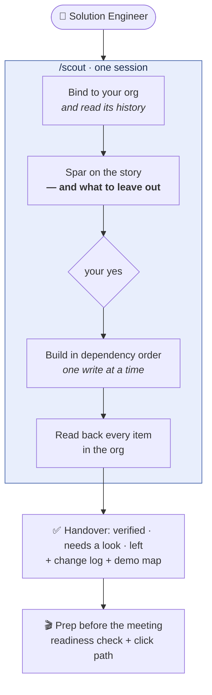

# SF Demo Scout

A Claude Code plugin for Salesforce Solution Engineers. Run `/scout` and say
what you need: Scout spars with you on the demo story, builds it in your demo
org, checks every piece there, and preps you for delivery, all in one session.
Scout 2.0 is built for Opus 5.5 and later.

## Why Scout exists

The SE role is shifting. We're increasingly asked to do post-sales
activation work — configuring real Salesforce orgs through CLI-native
tools that didn't exist 18 months ago — and the gap between what the
platform now expects and what most of us trained for is real. The tooling
landscape doesn't help: a dozen MCP servers, community skill repos, half a
dozen ways to stand up Claude Code. The cost of starting is high, and the
cost of starting wrong is higher.

Scout is the on-ramp. Setup stands up everything you need, and from there
`/scout` does four things:

1. **Works in the org you name.** It looks at exactly what your request
   touches (a full audit when you ask), so you build into reality instead of
   around it. If the org isn't connected yet, it opens Salesforce's login page
   for you. It never changes your existing logins, and changes your default org
   only on your yes, when Salesforce's deploy check needs one.
2. **Spars with you on the story.** From a one-liner or your discovery notes
   to a proposal with a clear "wow" moment, and pushback on anything that
   doesn't earn its place, because the real work is deciding what to leave out.
3. **Builds and checks the configuration.** In dependency order, one write at
   a time. It reads every item back in the org before calling it done, logs
   every change with rollback evidence, and asks before deleting or changing
   anything sensitive.
4. **Preps you for delivery.** The click path through your story, and a
   read-only readiness check before you present.

Scout works because it drives Salesforce's [official Claude
plugins](https://github.com/forcedotcom/sf-skills), installed from
Salesforce's own GitHub marketplace and kept current by auto-update, with an
orchestration layer for SEs on top. Rather than improvising Apex, Flow
XML, or agent metadata from training data, it uses the same authoring
rules and validation patterns the platform team publishes, the day they
publish them. You're not vibe-coding the platform layer — you're driving it.

## How it works

One session from idea to a checked demo. The 5.5 models carry the whole job;
Scout supplies the Salesforce playbook (Salesforce's official skills, deployment
rules, Salesforce Docs) and the SE rigour (org binding, confirmations, read-back,
per-customer history, and a log of what was done, with which skill, and why).



## What Scout builds — and what it leaves to you

Building used to be the hard part. It isn't anymore. Scout will attempt
anything the Metadata API can express — objects, flows, Apex, agents — and
loop on its own until it's deployed. Claude configures Salesforce more
reliably than most of us do by hand.

So the scarce discipline has moved. When everything is buildable, the
question that decides whether a demo lands is no longer *can we build
this* — it's *what's worth building, and what to leave out*. That judgment
doesn't automate, and it's the whole reason `/scout` spars first: the point
of sparring is to decide what **not** to build before a line is deployed.

Building, by contrast, is deliberately low-friction. Once you've approved
the proposal, Scout goes as far as the platform allows without stopping to
re-litigate the plan — the second-guessing already happened, with you, in
sparring. The one thing it never does is *pretend*: where it can check its
own work (a deploy read-back, a passing test, a fired agent action) it
reports a verified green; where it can't (a rendered layout, a visual UX)
it still builds and deploys, then hands you a short QA checklist rather
than claim a green it couldn't earn. And it never touches existing
metadata, or anything destructive, without your say-so.

| Scout builds and verifies | Scout builds it — you stay in the loop |
|---|---|
| Custom objects, fields, record types | Complex / multi-component LWC (deployed; visual QA) |
| Permission sets (incl. companion sets) | Existing Lightning-page field-section edits, page-layout arrangements, dashboards (deployed; visual QA) |
| Lightning apps, tabs, queues, reports | Screen flows using non-whitelisted components (deployed Draft; QA, then activate) |
| Flows — record-triggered, screen (branching, cross-screen), scheduled | Orchestration flows (deployed; you validate the lifecycle) |
| Apex — multi-class, cross-object (bounded test-fix loop) | Multi-agent wiring, channel assignment, OmniStudio (UI-only — Scout builds the metadata around them) |
| Agentforce agents (deploy, activate, smoke-test) | Anything destructive or on existing metadata — never without confirmation |

For Lightning Record Pages, additions to existing Dynamic Forms field sections
remain supported, and Scout still deploys underlying artifacts such as LWCs,
Paths, CompactLayouts, and ListViews. A full new `RecordPage` is composed
manually by the SE in App Builder, where the complete page can be arranged and
previewed safely.

## Install

Inside Claude Code, run these four commands in order:

```
/plugin marketplace add https://github.com/seb-schi/sf-demo-scout.git
/plugin install sf-demo-scout@scout
/reload-plugins
/scout-setup
```

When prompted on the install step, select `Install for you (user scope)`.
`/scout-setup` handles all prerequisites: Homebrew check, Node / Python /
Salesforce CLI install, SFDX scaffold, shell environment, and Slack MCP
registration + auth. It also installs Salesforce's official Claude plugins
from Salesforce's own GitHub marketplace, with auto-update on, so Scout always
drives Salesforce's latest skills.

After setup, kick off your first demo with `/scout`.

> **Full setup guide with videos and screenshots:**
> [Demo Scout Canvas](https://salesforce.enterprise.slack.com/docs/T01G0063H29/F0AQP1A7YMD)
> (internal Salesforce link)

## The commands

| Command | What it does |
|---|---|
| `/scout` | Scout 2.0: spar, build, fix or prep a demo in one session, in the org you name. Built for Opus 5.5 and later. |
| `/scout-setup` | Setup, updates, and repairs |

`/scout-sparring` and `/scout-building` are the classic command names. They now open `/scout`; `/scout-building` hands it your spec as the brief.

## Updates

Updates are automatic. Claude Code pulls new plugin versions on session
startup; if an update is downloaded but not yet installed, you'll see a
one-line banner suggesting `/scout-setup` to finish. To trigger manually:
`/plugin marketplace update scout`.

## Adoption

Scout began as unfunded personal work and grew into shared SE tooling —
piloted live at World Tour Frankfurt, forked by the US Regulated FDE org
for live customer orgs, and cloned 200+ times across a 100+ member SE
community spanning EMEA and AMER.

## Development checks

Run the [offline regression suite](tests/README.md) from a clean checkout with
`PYTHONDONTWRITEBYTECODE=1 python3 -B -m unittest discover -s tests -v`.
The fixtures use temporary files and synthetic CLI responses; they do not test
a live Salesforce org or install CLI updates.

## Archive

The full clone-install history is preserved at branch
`archive/clone-install-final` and tag `v-clone-install-final`.

## Questions

Ping `#sf-demo-scout` on Slack.

---

Built by **Sebastian Schickhoff** — Lead Solution Engineer, Applied AI &
Regulated Industries · [sebastian-schickhoff.com](https://sebastian-schickhoff.com)
